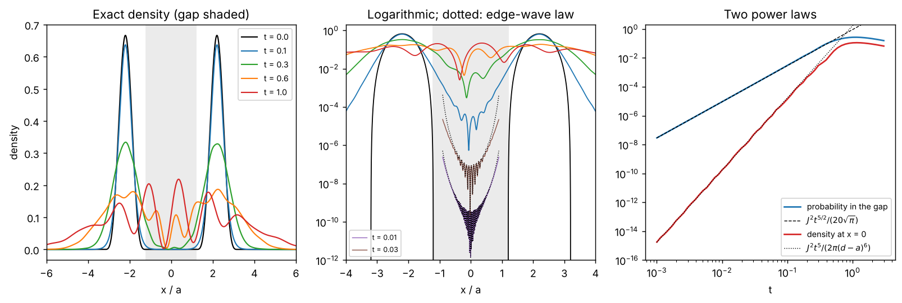
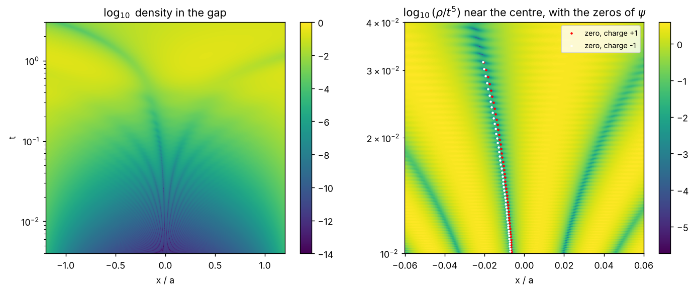
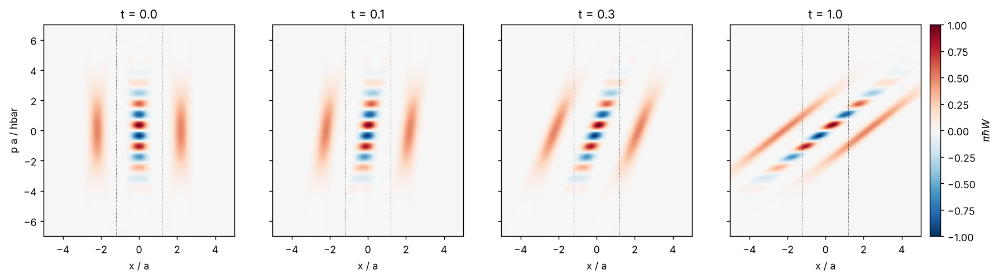
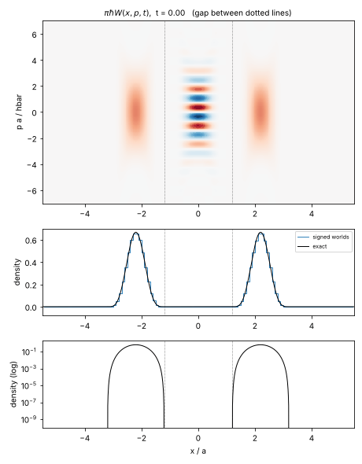
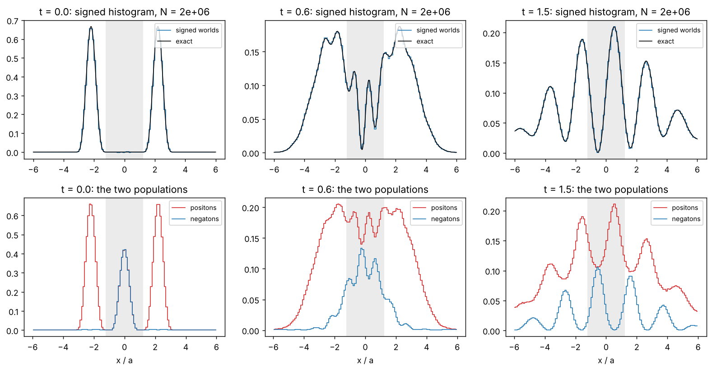

# A superposition with an empty gap: what is in the gap, and how it fills

**A wave function made of two pulses that are exactly zero between them has a
Wigner function that is not zero there: a band of fringes, positive and
negative in equal measure, sits in the middle of the gap. Under free
evolution the wave function, the Wigner function and the density are all
known in closed form. The gap fills at once, by two power laws: the
probability inside grows as the time to the power 5/2, and the density at a
fixed interior point as the fifth power. Fringes appear in the gap from the
first instant and the wave function has isolated zeros in the (x, t) plane
that accumulate at t = 0. In WPMW the whole evolution is streaming of signed
worlds with no event; what the example tests is the cost of reading a small
density off a signed ensemble.**

---

## 0. Status and provenance

Supplement to step 24 ([`../analysis/sea_depletion.md`](../analysis/sea_depletion.md)
§2, Proposition V1, "admissible negativity is free") and to
[`chord_action.md`](chord_action.md). Companion demo:
`src/demo_zero_gap_superposition.py`, which produces every number and figure
below. Figures and the animation are on the `output` branch.

The example is David Cyganski's. During the WPMW call of 10 November 2026 he
argued at the whiteboard that a wave function can be exactly zero on an
interval while its Wigner function is not, and afterwards sent two figures: a
raised-cosine pulse and a superposition of two of them, with the Wigner
function of the superposition. Bill Page had doubted the statement during the
call and asked, on 11 November: how do the Wigner function and the density
evolve, how does the gap fill, can it be computed reliably, can the
"instantaneous spreading" be quantified, does the gap develop nodes, and what
does a stochastic simulation of the WPMW model do with it?

The answers, in order. **Definition ZG0** fixes the state. **Proposition ZG1**
gives its Wigner function in closed form and says what is in the gap.
**Proposition ZG2** gives the exact free solution. **Proposition ZG3** gives
the laws by which the gap fills. **Proposition ZG4** describes the fringes and
the nodes. **Proposition ZG5** is the same evolution in phase space.
**Proposition ZG6** is the WPMW reading: signed worlds that stream and never
interact. **Remark ZG7** puts the state in a harmonic trap. **Remark ZG8**
connects the example to the "nodes issue" of Smolin's real-ensemble model.

Labels ZG0 to ZG8 and open items ZG-SP1 to ZG-SP3 belong to this supplement.

**Corrects nothing.** It supplies a worked case for Proposition V1 and for
Proposition R2 of
[`representation_cost_and_annihilation.md`](representation_cost_and_annihilation.md).

Units. Formulas keep $`\hbar`$ and the mass $`m`$. Numbers are in units
$`\hbar = m = a = 1`$, where $`a`$ is the half-width of one pulse, so the unit
of time is $`m a^2/\hbar`$.

---

## 1. The state (Definition ZG0)

**Definition ZG0.** *One pulse is*

```math
\psi_0(x) = A\cos^2\frac{\pi x}{2a} = \frac{A}{2}\Big(1 + \cos\kappa x\Big)\quad (\lvert x\rvert < a),\qquad \psi_0 = 0\ \text{otherwise},
```

*with $`\kappa = \pi/a`$ and $`A = 2/\sqrt{3a}`$, so that
$`\int\psi_0^2\,dx = 1`$. The state is*

```math
\psi(x) = \frac{1}{\sqrt2}\Big[\psi_0(x + d) + e^{i\theta}\,\psi_0(x - d)\Big],\qquad d = 2.2\,a,\quad \theta = \frac{\pi}{2}.
```

The pulses occupy $`1.2 < \lvert x\rvert/a < 3.2`$, and the **gap** is
$`\lvert x\rvert < g`$ with $`g = d - a = 1.2\,a`$. There $`\psi = 0`$ exactly.

$`\psi_0`$ and $`\psi_0'`$ vanish at the edges $`x = \pm a`$. The second
derivative does not: it jumps from $`0`$ to

```math
J = \psi_0''(\pm a) = \frac{A\kappa^2}{2} = \frac{\pi^2}{\sqrt3\,a^{5/2}} = 5.698,\qquad J^2 = \frac{\pi^4}{3a^5} = 32.47 .
```

This one number controls everything about how the gap fills. Each pulse
enters $`\psi`$ with weight $`1/\sqrt2`$, so its edges have jump
$`J/\sqrt2`$.

## 2. Proposition ZG1: the Wigner function, and what is in the gap

The Wigner function is taken as in `chord_action.md` §3, with $`y`$ the
half-chord:

```math
W(x, p) = \frac{1}{\pi\hbar}\int \psi^*(x + y)\,\psi(x - y)\,e^{2ipy/\hbar}\,dy .
```

**Proposition ZG1.** *(a) The Wigner function of one pulse is, for
$`\lvert x\rvert < a`$ and with $`L = a - \lvert x\rvert`$,
$`S(k) = 2\sin(kL)/k`$ and $`q = 2p/\hbar`$,*

```math
W_0(x, p) = \frac{A^2}{4\pi\hbar}\Big[\big(1 + \tfrac12\cos 2\kappa x\big)S(q) + \cos\kappa x\,\big(S(q + \kappa) + S(q - \kappa)\big) + \tfrac14\big(S(q + 2\kappa) + S(q - 2\kappa)\big)\Big],
```

*and $`W_0 = 0`$ for $`\lvert x\rvert \ge a`$.*

*(b) The Wigner function of the state is*

```math
W(x, p) = \tfrac12\big[W_0(x - d, p) + W_0(x + d, p)\big] + W_0(x, p)\,\cos\Big(\frac{2pd}{\hbar} - \theta\Big).
```

*(c) The last term, the band, is supported on $`\lvert x\rvert < a`$, inside
the gap. $`W`$ vanishes identically on the strips
$`a < \lvert x\rvert < d - a`$. At every $`x`$ in the gap
$`\int W\,dp = 0`$. Everywhere $`\lvert W\rvert \le 1/(\pi\hbar)`$.*

*Proof.* (a) For $`\lvert x\rvert < a`$ the product
$`\psi_0(x + y)\psi_0(x - y)`$ is supported on $`\lvert y\rvert < L`$ and
equals $`(A^2/4)[1 + 2\cos\kappa x\cos\kappa y + \tfrac12(\cos 2\kappa x + \cos 2\kappa y)]`$;
integrate term by term. (b) In the cross terms substitute $`y \to y \pm d`$.
(c) $`W(x, \cdot)`$ can differ from zero only where $`x`$ is the midpoint of
two points of the support of $`\psi`$, which gives the supports; the marginal
of any Wigner function is $`\lvert\psi(x)\rvert^2`$; the bound is the
Cauchy–Schwarz inequality. $`\square`$

Part A checks (a) and (b) against direct quadrature at nine values of $`x`$
and 181 of $`p`$: the largest difference is $`1.9\times10^{-13}`$.

| Quantity | Value |
|---|---|
| $`\pi\hbar W`$ at a lobe centre | $`0.5000`$ |
| $`\pi\hbar W(0, 0)`$ at $`\theta = \pi/2`$ | $`6\times10^{-17}`$ |
| fringe period in $`p`$, $`\pi\hbar/d`$ | $`1.4280`$ |
| first bright fringe, $`p = \pi\hbar/4d = 0.357`$ | $`\pi\hbar W = 0.9798`$ |
| extreme values of $`\pi\hbar W`$ | $`\pm0.9801`$ |
| $`\lvert W\rvert`$ on the strips $`a < \lvert x\rvert < d - a`$ | $`0`$ |
| in the gap: largest $`\lvert\int W\,dp\rvert`$ | $`8\times10^{-17}`$ |
| in the gap: largest $`\int\lvert W\rvert\,dp`$ | $`0.853`$ |
| purity $`2\pi\hbar\int W^2`$, with the band / lobes only | $`1.0000`$ / $`0.5000`$ |
| $`Z = \int\lvert W\rvert\,dx\,dp`$, state / lobes only | $`1.6631`$ / $`1.0162`$ |

These agree with Cyganski's figure of 10 November in every feature that can
be read from it: lobes at height one half, a white stripe along $`p = 0`$,
fringes of period about $`1.4`$, a red fringe just above $`p = 0`$ near full
scale, and blank strips next to the dotted lines.

**What is in the gap.** The wave function is zero there, and so is the
probability. The Wigner function is not: the band carries $`0.85`$ of
unsigned weight per unit length at the centre, in fringes whose integral over
$`p`$ cancels exactly. The envelope of the band, $`W_0(x, p)`$, does not
depend on $`\theta`$; the phase only slides the fringes, and
$`\pi\hbar W(0, 0) = \cos\theta`$. The band is the coherence of the two
pulses: without it the two lobes are the mixture
$`\tfrac12(\rho_1 + \rho_2)`$, with purity one half.

In WPMW the worlds of this state are sampled from $`\lvert W\rvert`$ with the
sign of $`W`$ (CA6(i)). So at $`t = 0`$ there are worlds in the gap,
positons and negatons in equal measure at every $`x`$, although no particle
is ever found there. That is the plainest picture of what a negaton is for.
A single pulse has faint negative ripples of its own ($`Z = 1.0162`$),
because only Gaussian states have a non-negative Wigner function (Hudson
1974). The ratio $`Z/Z_{\rm lobes} = 1.6366`$ equals, to the digits shown,
the $`1 + 2/\pi = 1.6366`$ of Proposition R2: fast fringes under a fixed
envelope cost a factor $`2/\pi`$.

## 3. Proposition ZG2: the exact free solution

For $`V = 0`$ the solution is elementary. The Moshinsky function

```math
M(x, k, t) = \tfrac12\,e^{i(kx - \hbar k^2 t/2m)}\,{\rm erfc}\Big(\frac{x - \hbar k t/m}{\sqrt{2i\hbar t/m}}\Big)
```

is the free evolution of $`e^{ikx}`$ cut off at $`x > 0`$ (Moshinsky 1952,
"diffraction in time").

**Proposition ZG2.** *The free evolution of one pulse is*

```math
\psi_0(x, t) = \sum_{k \in \{0, \kappa, -\kappa\}} c_k\Big[e^{ika}M(x - a, k, t) - e^{-ika}M(x + a, k, t)\Big],\qquad c_0 = \frac A2,\quad c_{\pm\kappa} = \frac A4 ,
```

*and $`\psi(x, t) = [\psi_0(x + d, t) + e^{i\theta}\psi_0(x - d, t)]/\sqrt2`$:
twelve Moshinsky functions.*

*Proof.* On its support $`\psi_0 = \sum_k c_k e^{ikx}`$, and the indicator of
$`(-a, a)`$ is a difference of two step functions. $`\square`$

**Reliability.** The demo evaluates $`M`$ through the Faddeeva function,
$`M = \tfrac12 e^{imx^2/2\hbar t}\,w(iz)`$ with $`z`$ the argument of the
error function. Part B compares it with the same formula in 40-digit
arithmetic:

| $`x`$ | $`t`$ | $`\lvert\psi\rvert^2`$ (40 digits) | relative error of $`\psi`$ in double precision |
|---|---|---|---|
| $`0`$ | $`0.02`$ | $`4.951\times10^{-9}`$ | $`6\times10^{-10}`$ |
| $`0.6`$ | $`0.1`$ | $`2.073\times10^{-4}`$ | $`2\times10^{-13}`$ |
| $`0`$ | $`0.3`$ | $`3.012\times10^{-3}`$ | $`6\times10^{-14}`$ |
| $`10`$ | $`0.01`$ | $`5.873\times10^{-15}`$ | $`3\times10^{-12}`$ |
| $`100`$ | $`0.01`$ | $`2.818\times10^{-23}`$ | $`1\times10^{-9}`$ |
| $`0`$ | $`0.001`$ | $`1.772\times10^{-15}`$ | $`1\times10^{-5}`$ |
| $`0.3`$ | $`0.0001`$ | $`3.937\times10^{-20}`$ | $`3\times10^{-2}`$ |

In the gap the twelve terms cancel, so double precision loses accuracy once
$`\lvert\psi\rvert`$ falls below about $`10^{-8}`$; above that it is good to
nine digits or better, and multiple precision removes the limit. A spectral
(FFT) propagation on $`2^{18}`$ points agrees with the closed form only to
between $`4\times10^{-10}`$ and $`2\times10^{-6}`$ in $`\psi`$, growing with
time. It is adequate for the bulk and useless for the early gap, where
$`\psi`$ itself is smaller than that.

**An exact gap cannot last.** A function that vanishes on an interval is not
analytic, and for every $`t \ne 0`$ the free evolution of a compactly
supported state is an entire function of $`x`$, so it cannot vanish on any
interval (Hegerfeldt 1998 reviews this "instantaneous spreading"). Nor can
the state be a stationary state of a bounded potential: an eigenfunction with
$`\psi = \psi' = 0`$ at one point vanishes identically. The gap exists at one
instant. Infinite walls would hold it, at the price of putting the gap outside
the domain.

## 4. Proposition ZG3: how the gap fills

**Proposition ZG3.** *Let an edge of a pulse be at $`x_e`$, with the pulse on
one side and jump $`J_e`$ of $`\psi''`$ there. Write $`\tau = \hbar t/m`$.*

*(a) At the edge itself $`\psi(x_e, t) \to \tfrac{i}{4}J_e\,\tau`$ as
$`t \to 0`$. For the state ZG0 the density at each former edge is
$`J^2\tau^2/32`$.*

*(b) The probability that has leaked past one edge is
$`\lvert J_e\rvert^2\tau^{5/2}/(20\sqrt\pi)`$ to leading order. For the state
ZG0 the probability in the gap is*

```math
P_{\rm gap}(t) \to \frac{J^2\,\tau^{5/2}}{20\sqrt\pi} = \frac{\pi^{7/2}}{60}\Big(\frac{\hbar t}{m a^2}\Big)^{5/2} = 0.91595\,\Big(\frac{\hbar t}{m a^2}\Big)^{5/2} .
```

*(c) At a point outside the pulses, at distances $`\lvert x - x_e\rvert \gg \sqrt\tau`$
from all edges, each edge sends a wave:*

```math
\psi(x, t) \simeq \frac{-i\,\tau^3}{\sqrt{2\pi i\tau}}\sum_e \eta_e\,J_e\,\frac{e^{i(x - x_e)^2/2\tau}}{(x_e - x)^3}\Big[1 - \frac{6i\tau}{(x - x_e)^2}\Big],
```

*where $`\eta_e = +1`$ if the pulse lies to the right of the edge and $`-1`$
if to the left. A single edge at distance $`s`$ gives the density
$`\lvert J_e\rvert^2\tau^5/(2\pi s^6)`$.*

*Proof.* (c) The free propagator is
$`(2\pi i\tau)^{-1/2}e^{i(x - x')^2/2\tau}`$. Near an edge
$`\psi(x') = \tfrac12 J_e(x' - x_e)^2`$ on the pulse side. Since $`x`$ is
outside the support the phase has no stationary point, and three integrations
by parts leave the boundary term $`-iJ_e\tau^3/(x_e - x)^3`$ times the phase
at the edge, with the sign $`\eta_e`$. Expanding the quadratic part of the
phase once more gives the factor in brackets. (a) and (b) By scaling, the
evolution of $`\tfrac12 J_e u^2`$ on $`u > 0`$ is $`J_e\tau\,G(u/\sqrt\tau)`$
with a fixed function $`G`$. Two Fresnel integrals give $`G(0) = i/4`$ and
$`G'(0) = e^{i\pi/4}/\sqrt{2\pi}`$. The probability on $`u < 0`$ grows at the
rate of the current through $`u = 0`$,
$`-(\hbar/m)\,{\rm Im}\,\psi^*\partial_u\psi = \lvert J_e\rvert^2\tau^{3/2}(\hbar/m)/(8\sqrt\pi)`$,
whose integral is (b). The gap has two inner edges, each with
$`\lvert J_e\rvert^2 = J^2/2`$. $`\square`$

Part C checks all three.

*(a)* The ratio of the exact density at $`x = d - a`$ to
$`J^2\tau^2/32`$ is $`1.0000`$, $`0.9999`$, $`0.9937`$ at
$`t = 0.001`$, $`0.01`$, $`0.05`$.

*(b)*

| $`t`$ | $`P_{\rm gap}`$ | $`P_{\rm gap}/t^{5/2}`$ |
|---|---|---|
| $`0.00125`$ | $`5.064\times10^{-8}`$ | $`0.9166`$ |
| $`0.005`$ | $`1.624\times10^{-6}`$ | $`0.9186`$ |
| $`0.02`$ | $`5.240\times10^{-5}`$ | $`0.9264`$ |
| $`0.1`$ | $`3.024\times10^{-3}`$ | $`0.9561`$ |
| $`0.3`$ | $`4.856\times10^{-2}`$ | $`0.9851`$ |
| $`0.6`$ | $`0.1885`$ | — |
| $`1.0`$ | $`0.2674`$ | — |
| $`2.0`$ | $`0.2144`$ | — |
| $`4.0`$ | $`0.1219`$ | — |

The power law holds to 7 % up to $`t = 0.3`$. The gap holds 1 % of the
probability at $`t = 0.16`$ and 10 % at $`t = 0.41`$; the content peaks at
$`0.270`$ at $`t = 1.10`$ and then falls as the whole state disperses.

*(c)* Relative error of $`\psi`$ from the edge-wave formula, without and with
the bracket:

| $`t`$ | $`\rho(0, t)`$ exact | leading, at $`x = 0`$, $`0.3`$, $`0.6`$ | with the bracket |
|---|---|---|---|
| $`0.005`$ | $`4.890\times10^{-12}`$ | $`0.022`$, $`0.041`$, $`0.086`$ | $`0.0004`$, $`0.0016`$, $`0.0083`$ |
| $`0.01`$ | $`1.555\times10^{-10}`$ | $`0.044`$, $`0.069`$, $`0.169`$ | $`0.0016`$, $`0.0051`$, $`0.032`$ |
| $`0.02`$ | $`4.951\times10^{-9}`$ | $`0.087`$, $`0.172`$, $`0.320`$ | $`0.0062`$, $`0.028`$, $`0.118`$ |
| $`0.05`$ | $`4.721\times10^{-7}`$ | $`0.216`$, $`0.329`$, $`0.785`$ | $`0.038`$, $`0.113`$, $`0.674`$ |

The local exponent $`d\ln\rho(0, t)/d\ln t`$ is $`4.99`$ between
$`t = 0.005`$ and $`0.02`$.

So the gap fills in two ways at once, on two scales. Next to each edge a
boundary layer of width $`\sqrt{\hbar t/m}`$ carries nearly all the leaked
probability, which is why $`P_{\rm gap}`$ goes as $`t^{5/2}`$. Deep in the gap
the density is far smaller and goes as $`t^5/s^6`$. Both come from the jump
$`J`$. A smoother pulse would fill more slowly: a jump in the $`n`$-th
derivative gives $`t^{n + 1/2}`$ for the leak and $`t^{2n+1}`$ for the deep
density, by the same argument.



**"Instantaneous spreading", quantified.** At $`t = 0.01`$, when the gap
holds $`9\times10^{-6}`$ of the probability, the exact density is

| $`x`$ | $`\rho`$ (60 digits) | edge-wave law |
|---|---|---|
| $`10`$ | $`5.8729\times10^{-15}`$ | $`5.8727\times10^{-15}`$ |
| $`100`$ | $`2.8178\times10^{-23}`$ | $`2.8178\times10^{-23}`$ |
| $`1000`$ | $`6.4290\times10^{-30}`$ | $`6.4290\times10^{-30}`$ |

It is not zero anywhere, at any positive time. It is also nothing more than
the momentum distribution seen ballistically. The momentum density of one
pulse is

```math
\lvert\varphi_0(p)\rvert^2 = \frac{A^2}{2\pi\hbar}\Big[\frac{\kappa^2\sin(pa/\hbar)}{(p/\hbar)\,(\kappa^2 - p^2/\hbar^2)}\Big]^2 \;\sim\; \frac{2J^2\hbar^5}{\pi p^6}\sin^2\frac{pa}{\hbar},
```

and the tail of (c), averaged over its fringes, is
$`(m/t)\lvert\varphi(mx/t)\rvert^2`$. A world with momentum $`p`$ is at
distance $`pt/m`$ at time $`t`$. Nothing travels faster than its own
momentum allows; the initial state simply contains every momentum, with
weight falling as $`p^{-6}`$.

## 5. Proposition ZG4: fringes and nodes

**Proposition ZG4.** *(a) Early, near the centre of the gap, the waves from
the two inner edges interfere with phase difference
$`2gx/\tau - \theta`$: the density has fringes of spacing
$`\pi\hbar t/(m g)`$, which widen linearly in time from zero.*

*(b) Late, $`t\rho(x, t) \to m\lvert\varphi(mx/t)\rvert^2`$ with
$`\lvert\varphi(p)\rvert^2 = \lvert\varphi_0(p)\rvert^2\,[1 + \cos(2pd/\hbar - \theta)]`$:
fringes of spacing $`\pi\hbar t/(m d)`$, with minima at
$`mx/t = \hbar(\theta + (2n + 1)\pi)/2d`$ that become exact zeros as
$`t \to \infty`$.*

*(c) For $`\theta = \pi`$ the state is odd and $`\psi(0, t) = 0`$ for all
$`t`$. For any other $`\theta`$, $`\psi(0, t) \ne 0`$ for $`t > 0`$, and
$`\rho(0, t) = \lvert\psi_0(d, t)\rvert^2(1 + \cos\theta)`$.*

*(d) For $`\theta = \pi/2`$ the zeros of $`\psi`$ in the $`(x, t)`$ plane are
isolated points. In the gap they occur only for $`t < 0.0316`$, in pairs of
opposite winding number, and they accumulate at $`t = 0`$.*

*Proof.* (a) and (b) follow from ZG3(c) and from the far-field limit of the
free propagator. (c) By the mirror symmetry of $`\psi_0`$,
$`\psi_0(x + d, t)`$ and $`\psi_0(x - d, t)`$ are equal at $`x = 0`$, so
$`\psi(0, t) = \psi_0(d, t)(1 + e^{i\theta})/\sqrt2`$. (d) is numerical; the
mechanism is below. $`\square`$

Part D measures the spacing of the minima nearest the centre:

| $`t`$ | spacing | $`\pi t/g`$ | minimum/maximum |
|---|---|---|---|
| $`0.005`$ | $`0.01308`$ | $`0.01309`$ | $`1\times10^{-4}`$ |
| $`0.01`$ | $`0.02615`$ | $`0.02618`$ | $`3\times10^{-5}`$ |
| $`0.02`$ | $`0.05210`$ | $`0.05236`$ | $`4\times10^{-4}`$ |
| $`0.05`$ | $`0.12784`$ | $`0.13090`$ | $`3\times10^{-3}`$ |

and late, in the variable $`x/t`$: minima at $`-0.357`$ and $`1.071`$
(expected $`-0.3570`$, $`1.0710`$), spacing $`1.4280 = \pi/d`$, with
minimum/maximum $`4\times10^{-4}`$, $`3\times10^{-5}`$, $`1\times10^{-6}`$ at
$`t = 5`$, $`20`$, $`100`$.

**Nodes.** In one dimension a complex $`\psi(x, t)`$ vanishes where two real
functions vanish, so its zeros are generically isolated points of the
$`(x, t)`$ plane, the wave dislocations of Nye and Berry (1974). At a fixed
time the density then has deep minima but no zero, except at the instants
when a dislocation passes. The demo finds them by the winding of the phase
around each cell of a grid:

| window, $`\lvert x\rvert < 0.06`$ | zeros | total winding | $`2ad\,(1/t_1 - 1/t_2)/\pi`$ |
|---|---|---|---|
| $`0.005 < t < 0.01`$ | $`237`$ | $`-1`$ | $`140`$ |
| $`0.01 < t < 0.02`$ | $`70`$ | $`0`$ | $`70`$ |
| $`0.02 < t < 0.04`$ | $`26`$, the last at $`t_2 = 0.0315`$ | $`0`$ | $`25.6`$ |
| $`0.04 < t < 0.08`$ | $`0`$ | $`0`$ | — |
| $`0.08 < t < 6`$, whole gap | $`0`$ | | |

The last zero, refined in 40-digit arithmetic, is at $`x = -0.0206521`$,
$`t = 0.0315226`$, where $`\lvert\psi\rvert = 6\times10^{-41}`$. The mechanism
is the interference of three waves. The inner-edge waves have equal
amplitude only near $`x = 0`$, and their minimum nearest the centre lies on
the line $`x = -\pi\tau/4g`$. The waves from the two outer edges are weaker by
$`(g/(d + a))^3 = 0.053`$, and their phase relative to the inner ones is
$`2ad/\tau`$ at the centre, which turns faster and faster as $`t \to 0`$.
On each turn the residual amplitude at that minimum passes through zero
twice, which gives a pair of zeros of opposite winding. That is the last
column, counted from $`t_1`$ to $`t_2`$ (or to the last zero), and it accounts
for the zeros down to $`t = 0.01`$. Below that a second family appears and
the count is larger. After $`t = 0.0316`$ the outer
waves are no longer able to cancel the residual and the gap has no zeros.



## 6. Proposition ZG5: the same evolution in phase space

**Proposition ZG5.** *For $`V = 0`$,
$`W(x, p, t) = W(x - pt/m, p, 0)`$: a shear. The density splits as*

```math
\rho(x, t) = \underbrace{\tfrac12\int\big[W_0(x - d - \tfrac{pt}{m}, p) + W_0(x + d - \tfrac{pt}{m}, p)\big]dp}_{\text{lobes}} + \underbrace{\int W_0(x - \tfrac{pt}{m}, p)\cos\Big(\frac{2pd}{\hbar} - \theta\Big)dp}_{\text{band}},
```

*where the first term is
$`\tfrac12[\lvert\psi_0(x - d, t)\rvert^2 + \lvert\psi_0(x + d, t)\rvert^2]`$
and the second is
$`{\rm Re}\,[e^{i\theta}\psi_0^*(x + d, t)\,\psi_0(x - d, t)]`$.*

*Proof.* The Moyal bracket reduces to the Poisson bracket for a quadratic
Hamiltonian, so $`W`$ is carried along the classical flow. The two terms are
the Wigner transforms of the diagonal and off-diagonal parts of
$`\lvert\psi\rangle\langle\psi\rvert`$, each of which evolves separately.
$`\square`$

Part E, at four times and two positions:

| $`t`$ | $`x`$ | $`\lvert\psi\rvert^2`$ | from the sheared $`W`$ | lobes | band | $`\int\lvert W\rvert dp`$ |
|---|---|---|---|---|---|---|
| $`0.1`$ | $`0`$ | $`1.412307\times10^{-5}`$ | $`1.412307\times10^{-5}`$ | $`1.412\times10^{-5}`$ | $`0`$ | $`0.812`$ |
| $`0.1`$ | $`0.4`$ | $`5.009537\times10^{-5}`$ | $`5.009537\times10^{-5}`$ | $`6.056\times10^{-5}`$ | $`-1.047\times10^{-5}`$ | $`0.350`$ |
| $`0.3`$ | $`0.4`$ | $`3.101894\times10^{-3}`$ | $`3.101894\times10^{-3}`$ | $`5.197\times10^{-3}`$ | $`-2.095\times10^{-3}`$ | $`0.348`$ |
| $`0.6`$ | $`0.4`$ | $`8.175750\times10^{-2}`$ | $`8.175750\times10^{-2}`$ | $`6.258\times10^{-2}`$ | $`+1.918\times10^{-2}`$ | $`0.272`$ |
| $`1.0`$ | $`0.4`$ | $`0.2168007`$ | $`0.2168007`$ | $`0.1107`$ | $`+0.1061`$ | $`0.247`$ |

The band column agrees with the wave-function expression to all the digits
printed by the demo. At $`x = 0`$ and $`\theta = \pi/2`$ the band contributes
nothing at any time, by ZG4(c).

So in phase space the gap fills in the only way a shear allows. The momentum
tails of the two lobes lean over into it, and the band, which was already
there, tilts. While its fringes were horizontal they integrated to zero over
$`p`$; tilted, they no longer do, and their integral is the interference term
of the density. Nothing is created. The last column is the unsigned weight
per unit length at that point, the density of worlds. At the centre it is
$`0.85`$ at $`t = 0`$ against a density of zero, $`0.81`$ at $`t = 0.1`$
against $`1.4\times10^{-5}`$ (a ratio of $`6\times10^{4}`$), and $`0.24`$ at
$`t = 1`$ against $`0.110`$ (a ratio of $`2.2`$).





## 7. Proposition ZG6: signed worlds

**Proposition ZG6.** *For $`V = 0`$ the WPMW model of Definition CA6 has no
events. An ensemble of worlds sampled from $`\lvert W\rvert/Z`$ with signs
$`\varepsilon = {\rm sgn}\,W`$ streams, each world at its own constant
momentum, and for every $`t`$*

```math
\rho(x, t) = Z\,\Big\langle \varepsilon\,\delta\big(x - x_w - \tfrac{p_w t}{m}\big)\Big\rangle .
```

*With $`N`$ worlds and bins of width $`\Delta`$, the signed histogram
estimates $`\rho`$ with standard deviation*

```math
\sigma = \sqrt{\frac{Z\,n(x, t)}{N\Delta}},\qquad n(x, t) = \int\Big\lvert W\big(x - \tfrac{pt}{m}, p, 0\big)\Big\rvert\,dp .
```

*Proof.* The compensated residual $`R`$ vanishes for a potential that is at
most quadratic (CA2(b)), so the kernel $`\Theta`$ of CA3 is zero and no world
parents an event. Aligned pairs move nothing in $`W`$ (CA6(iv)). What is left
is ZG5 read as an expectation. The variance is that of a sum of $`N`$
independent terms $`\pm Z/(N\Delta)`$, each present with probability
$`n\Delta/Z`$. $`\square`$

Part F samples $`N = 2\times10^6`$ worlds by rejection from the closed form
of ZG1 on $`\lvert p\rvert < 40`$ (the weight beyond is $`3\times10^{-4}`$).
The acceptance is $`0.0102`$, which is $`Z\pi`$ over the area of the box, and
the fraction of positons is $`0.8006`$, which is $`(1 + 1/Z)/2`$.

| $`t`$ | positons in the gap | negatons in the gap | signed estimate of $`P_{\rm gap}`$ | exact | $`\sigma`$ |
|---|---|---|---|---|---|
| $`0`$ | $`388\,137`$ | $`389\,078`$ | $`-0.0008`$ | $`0`$ | $`0.0007`$ |
| $`0.1`$ | $`391\,387`$ | $`388\,726`$ | $`+0.0022`$ | $`0.0030`$ | $`0.0007`$ |
| $`0.3`$ | $`425\,968`$ | $`368\,416`$ | $`+0.0479`$ | $`0.0486`$ | $`0.0007`$ |
| $`0.6`$ | $`499\,281`$ | $`273\,417`$ | $`+0.1878`$ | $`0.1885`$ | $`0.0007`$ |
| $`1.0`$ | $`503\,492`$ | $`182\,901`$ | $`+0.2666`$ | $`0.2674`$ | $`0.0007`$ |
| $`1.5`$ | $`425\,958`$ | $`124\,233`$ | $`+0.2509`$ | $`0.2513`$ | $`0.0006`$ |

At $`t = 0`$, 39 % of all the worlds are in the gap, and they cancel to
within about one standard deviation. Over the 24 gap bins of width $`0.1`$ the
residuals divided by $`\sigma`$ have root mean square $`1.14`$ at $`t = 0.3`$
and $`1.08`$ at $`t = 1`$, so the formula for $`\sigma`$ is right.



**What the run shows.** The fringes that appear in the gap are fully
reproduced by worlds that never interact. Each world moves in a straight
line. The interference is in the signs: where the density has a minimum, as
many negatons as positons arrive. This is Proposition V1 in its simplest
form, and it is the point Cyganski made in the call when he said that the
real, signed Wigner function already holds the phase.

**What it costs.** The early gap is beyond any ensemble. To see
$`\rho(0, t)`$ at three standard deviations in a bin of width $`0.1`$ needs

| $`t`$ | $`\rho(0, t)`$ | worlds needed |
|---|---|---|
| $`0.05`$ | $`4.7\times10^{-7}`$ | $`6\times10^{14}`$ |
| $`0.1`$ | $`1.4\times10^{-5}`$ | $`6\times10^{11}`$ |
| $`0.2`$ | $`4.6\times10^{-4}`$ | $`4\times10^{8}`$ |
| $`0.3`$ | $`3.0\times10^{-3}`$ | $`7\times10^{6}`$ |
| $`0.6`$ | $`5.3\times10^{-2}`$ | $`1.5\times10^{4}`$ |
| $`1.0`$ | $`0.110`$ | $`3\times10^{3}`$ |

The $`t^5`$ law, the fringes of §5(a) and the dislocations of §5(d) all lie
in the first rows. They are properties of the exact signed measure that no
finite sample of it shows. This is the readout cost of Definition R1 at a
point where the density is small and the world density is not, and it does
not depend on the dynamics: an exact generator applied to $`N`$ worlds has
the same floor. Cancelling the worlds in the gap against each other is not
an option. The positons and negatons there sit on different fringes, at
different momenta, and that separation in momentum is the coherence of the
two pulses: a resampling step (step 26) coarse enough to merge them would
turn the superposition into the mixture.

## 8. Remark ZG7: a harmonic trap

**Remark ZG7.** In $`V = \tfrac12 m\omega^2x^2`$ the residual is still zero
and the flow is a rigid rotation of phase space (in units with
$`m\omega = 1`$),
$`W(x, p, t) = W(x\cos\omega t - p\sin\omega t,\; x\sin\omega t + p\cos\omega t,\; 0)`$.
At a quarter period the density is the momentum density,
$`\rho(x) = \lvert\varphi(x)\rvert^2`$, with **exact** nodes at
$`x = (\theta + (2n + 1)\pi)/2d = -0.357,\ 1.071,\ 2.499`$ (and at the zeros of $`\varphi_0`$, $`\lvert x\rvert = 2\pi, 3\pi, \dots`$). At a half period
the state is its own mirror image and the gap is empty again; at a full
period it returns. Part G checks the densities from the rotated closed form
($`0.212207`$ against $`\lvert\varphi(0)\rvert^2 = 0.212207`$; zero in the
gap at $`t = \pi`$ and $`2\pi`$ to $`2\times10^{-17}`$) and rotates the same
$`2\times10^6`$ worlds: the signed content of the gap is $`-0.0008`$,
$`0.3799`$, $`0.4785`$, $`-0.0008`$ at $`\omega t = 0`$, $`\pi/4`$,
$`\pi/2`$, $`\pi`$, against the exact $`0`$, $`0.3804`$, $`0.4789`$, $`0`$,
each within $`0.0008`$.

So in a trap the gap fills, shows exact nodes and empties again, and through
all of it no world interacts with any other. The worlds that cancel in the
gap at $`t = 0`$ are the same ones that cancel there half a period later.

## 9. Remark ZG8: Smolin's nodes issue, and what this example is not

**Remark ZG8.** Smolin's real-ensemble model (2012) represents a pure state by
a positive ensemble whose members each carry a value $`a`$ of a chosen
observable and a phase, and move by copying one another. Its rate equation
for the occupation $`\rho_a`$ is
$`\dot\rho_a \propto \sum_b\sqrt{\rho_a\rho_b}\,R_{ab}\sin(\phi_a - \phi_b + \delta_{ab})`$.
If $`\rho_a = 0`$ there is nothing to copy and $`\dot\rho_a = 0`$ whatever the
phases: Smolin calls this "the nodes issue" and lists it as the most serious
open problem of the model. A state with an empty gap, in a position basis,
is that problem on an interval. The Schrödinger equation fills the gap by
ZG3, and a copy rule on a positive ensemble cannot begin to. Smolin's
suggested repairs are to add "a small number of spectator states" at every
value, or a small admixture of a state that is nowhere zero. In WPMW the
question does not arise, because the object sampled is $`W`$, which is
linear in the state and already non-zero in the gap. In Cyganski's Volterra
sea the uniform depth $`B`$ plays the role of Smolin's spectator population.

**What this example is not.** It is not a test of the events of the model,
which need a potential beyond quadratic. It shows the kinematics of signed
worlds at their clearest, and it supplies exact reference data. The same
state with a smooth barrier in the gap would test events against an exact
gap-filling law, with the cost of §7 as the known floor (ZG-SP2).

## 10. Open items

- **ZG-SP1.** The zeros of ZG4(d) are found numerically. A proof of the
  count, and of the time of the last one, from the three-wave picture.
- **ZG-SP2.** The same state with a weak anharmonic potential in the gap,
  for example $`V_1\cos kx`$ on $`\lvert x\rvert < g`$. Events now occur, and
  only in the gap, where the world density is $`0.85`$ and the particle
  density is zero. What is the first-order change of $`P_{\rm gap}(t)`$, and
  how many worlds does a compensated run need to show it?
- **ZG-SP3.** Two particles, each in a zero-gap state, with a pair
  interaction: the two-particle form of the question, in which the band is a
  set of worlds in the four-dimensional gap.

## References

- Hegerfeldt, G. C. — "Instantaneous spreading and Einstein causality in
  quantum theory." *Ann. Phys. (Leipzig)* **7**, 716–725 (1998).
  https://arxiv.org/abs/quant-ph/9809030
- Hudson, R. L. — "When is the Wigner quasi-probability density
  non-negative?" *Rep. Math. Phys.* **6**, 249–252 (1974).
- Moshinsky, M. — "Diffraction in time." *Phys. Rev.* **88**, 625–631 (1952).
  https://doi.org/10.1103/PhysRev.88.625
- Nye, J. F.; Berry, M. V. — "Dislocations in wave trains." *Proc. R. Soc.
  Lond. A* **336**, 165–190 (1974). https://doi.org/10.1098/rspa.1974.0012
- Smolin, L. — "A real ensemble interpretation of quantum mechanics."
  *Found. Phys.* **42**, 1239–1261 (2012). https://arxiv.org/abs/1104.2822
- Wigner, E. — "On the quantum correction for thermodynamic equilibrium."
  *Phys. Rev.* **40**, 749–759 (1932).

Full entries are in [`../../references/bibliography.md`](../../references/bibliography.md).
